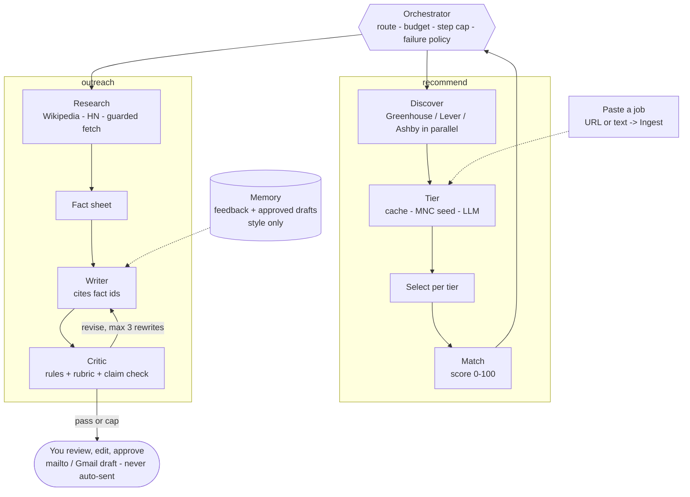

# NextRole

Agentic job search and outreach: parse a resume, find real openings from legitimate sources (Greenhouse, Lever, Ashby, Adzuna), tier companies (Startup / Mid-size / MNC), explain fit, link to the real application page, and draft a grounded, human-approved outreach message. Built with prompting, tool use and LangGraph orchestration only.

> Status: milestone f (LangGraph orchestrator, live SSE feed, memory, paste-a-job). See the roadmap below.

## Setup
```bash
uv sync
cp .env.example .env   # add ANTHROPIC_API_KEY
uv run pytest -q
uv run python -m nextrole.baseline_demo
```

## Roadmap
a. Foundations + baseline (done) · b. Job connectors (done) · c. Auth + resume parsing (done) · d. Tiering, ranking, dashboard (done) · e. Researcher/Writer/Critic (done) · f. Orchestrator, budgets, memory (done) · g. Evaluation

## Agent flow
Every run is a LangGraph graph: each worker step returns to the **Orchestrator**, the one place that routes, enforces the budget, the step cap and the rewrite cap, and applies each step's failure policy. Steps stream to the UI over SSE.



## Evaluation results
_Added in milestone g._
